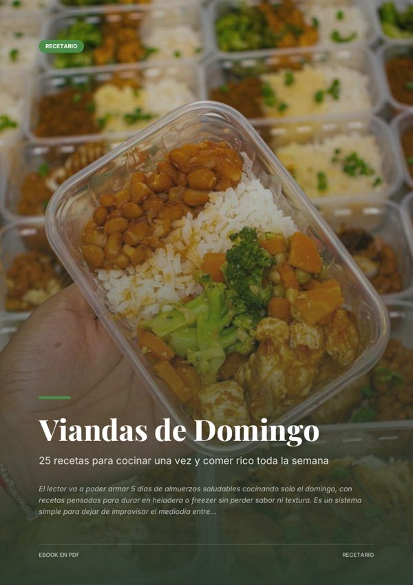
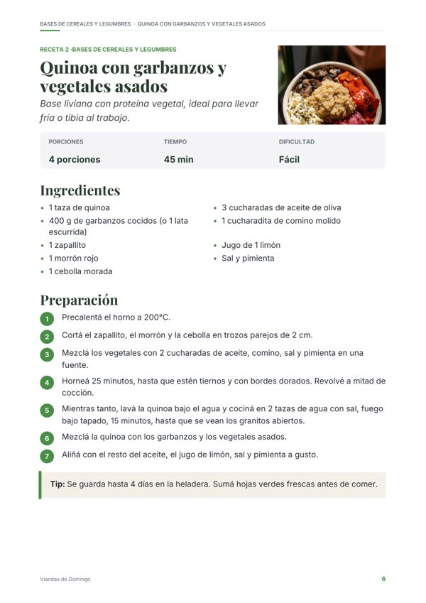

# MenduEbook

**A platform that uses artificial intelligence to create a complete PDF ebook and its sales page, ready to sell.**

The customer enters a topic, chooses the audience and the tone, and within a few minutes receives the designed book, a sales landing page that connects to their payment link, and instructions to publish it. It is live, takes payments through Mercado Pago and has already generated more than 60 books.

**See it running:** [mendumarket.com.ar](https://mendumarket.com.ar)

---

## What it does

- **Writes the book with AI** (Claude) and picks the right format: a 60-page guide, a 25-recipe cookbook or a 30-page coloring book.
- **Designs the PDF** with cover, table of contents, chapters, photos and typography, ready to print.
- **Draws the coloring pages with AI** (OpenAI) and reuses the ones it already made to lower costs.
- **Builds the book's sales landing page**, with a panel where the customer pastes their payment link and price.
- **Shows progress live:** the table of contents fills in on screen while the AI writes.
- **Takes payments through Mercado Pago:** credits (1 credit = 1 ebook), packs, a bonus on the first purchase and prices in pesos at the day's dollar rate.
- **Translates** the book, the landing page and the checkout into other languages.
- **Admin panel:** sales, real AI cost per book, users, payments and manual credit top-ups.
- **Complies with Argentine consumer law:** terms, privacy policy and a cancellation button.
- **Protected free sample:** downloadable after sign-up, watermarked, and its landing page cannot be published.

## Real examples generated by the platform

Covers of three books made by MenduEbook, one of each format:

| Recipe book | Practical guide | Coloring book |
|:---:|:---:|:---:|
|  |  |  |
|  |  |  |

| Generated sales landing page | The site on a phone |
|:---:|:---:|
|  |  |

## Built with

| Part | Technology |
|---|---|
| Server and pages | Python, Flask, Jinja templates, HTML, CSS and JavaScript |
| Artificial intelligence | Claude API (Anthropic) for text, OpenAI API for illustrations |
| PDF | Custom layout engine, Inter and Playfair Display fonts, photos from Pexels |
| Database | SQLite |
| Payments | Mercado Pago Checkout Pro, with automatic payment notifications (webhook) |
| Sign-in | Google login (OAuth) |
| Hosting | Own cloud server (Ubuntu), Gunicorn, HTTPS |

## Source code

The full source code is private.

> If you are a company and want to review the code for an evaluation, contact me and I will give you read access.

## Author

**Adrián Pereyra**, Mendoza, Argentina. Software development, websites and tools with Python and AI. Digital and content marketing for social media.

- Email: [adrianpereyra884@gmail.com](mailto:adrianpereyra884@gmail.com)
- WhatsApp: [+54 261 637-3263](https://wa.me/542616373263)
- More projects: [github.com/adrian884hub](https://github.com/adrian884hub)

---

© 2026 Adrián Pereyra. **All rights reserved.** This repository is for showcase purposes only: copying, using or redistributing the text or images without written permission is not allowed. See [LICENSE](LICENSE).
